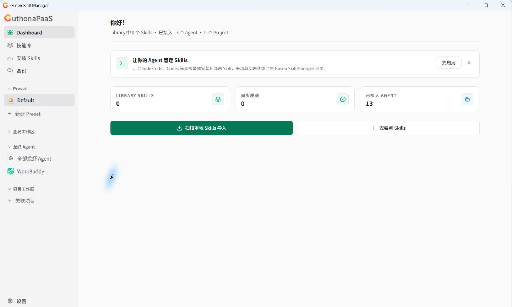
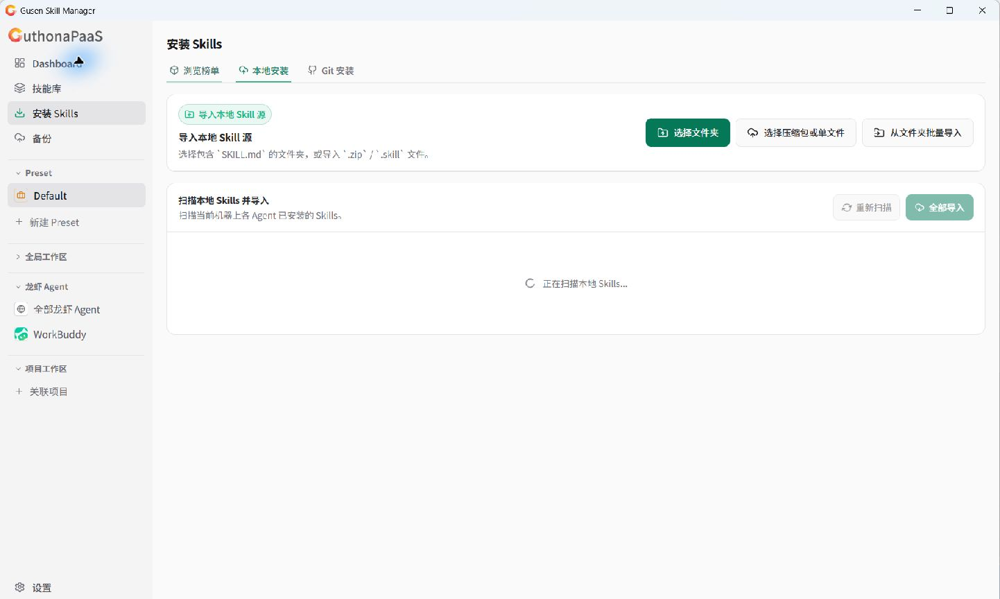
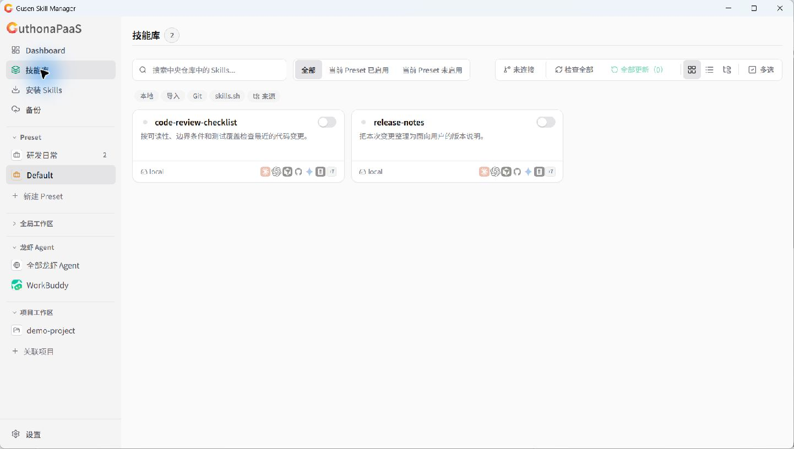
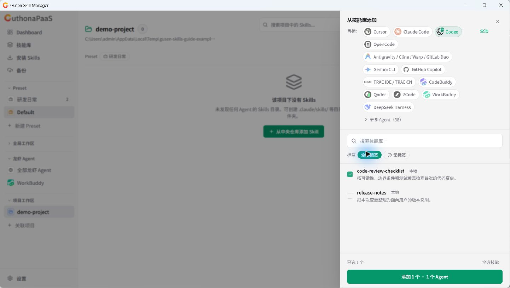
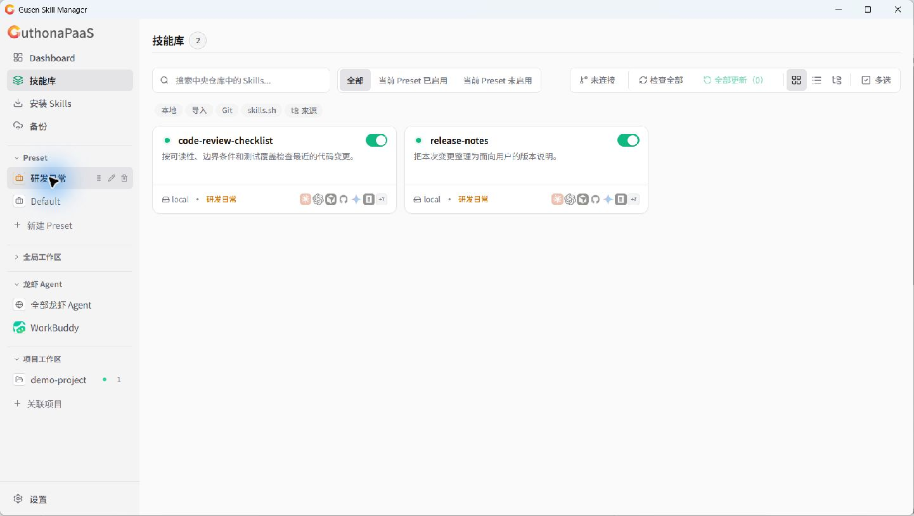
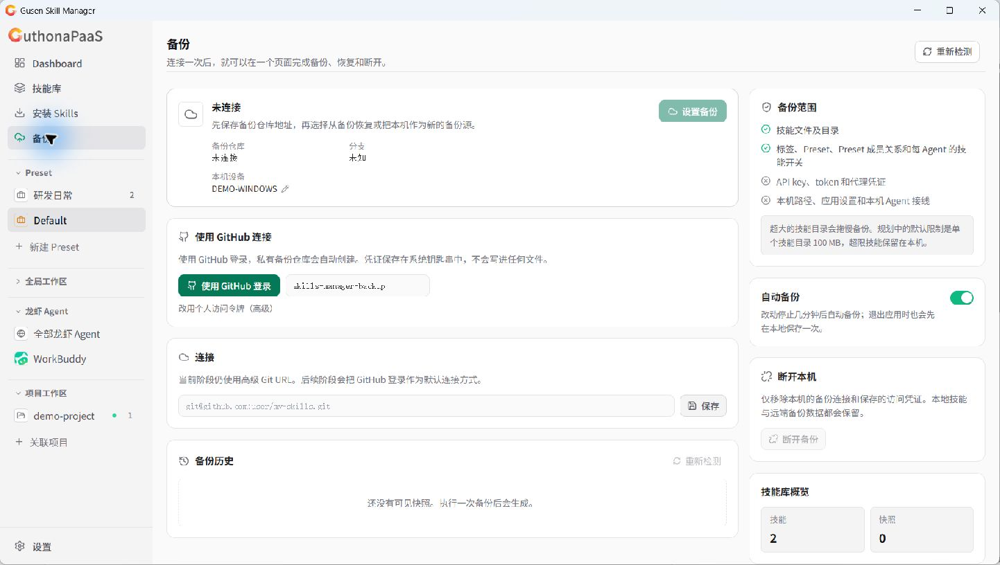

# Skills Manager 中文使用指南

Skills Manager 把各个 Agent 的 Skills 集中到一个技能库。你可以从本地、Git 仓库或内置的谷神技能来源导入 Skill，再部署给 Codex、Claude Code、Cursor 等 Agent，也可以只部署到指定项目。

[安装应用](#安装应用) · [导入技能](#导入技能) · [部署到全局工作区](#部署到全局工作区) · [部署到指定项目](#部署到指定项目) · [批量使用 Preset](#批量使用-preset) · [备份与恢复](#备份与恢复)

## 安装应用

1. 打开 [GitHub Releases](https://github.com/sulishijian/gusen-skills-manager/releases/latest)。Windows x64 用户在 **Assets** 中下载 `skills-manager_<版本>_x64-setup.exe`，运行安装程序后打开应用。
2. 如果界面是英文，打开左下角 **Settings**，找到 **Language**，选择 **简体中文**。
3. 首次启动时，选择 **全新开始**。已有备份的用户可以输入备份仓库地址，选择 **连接并恢复**。

> 截图来自 Windows 桌面版 1.44.2 的简体中文界面，使用示例数据。

## 导入技能

打开左侧 **安装 Skills**，按手头的来源选择一种方式。

| 来源 | 操作 |
| --- | --- |
| 本地文件夹 | 选 **本地安装 → 选择文件夹**，打开直接包含 `SKILL.md` 的目录。一个父目录下有多个 Skill 时，可用 **从文件夹批量导入**。 |
| 压缩包 | 选 **本地安装 → 选择压缩包或单文件**，导入 `.zip` 或 `.skill`。 |
| Git 仓库 | 选 **Git 安装**，粘贴仓库地址，点 **克隆并预览**。勾选所需技能，再点 **导入选中项**。 |
| 谷神技能来源 | 打开 **浏览技能**，在 `@sulishijian/gusen-skills` 中搜索技能。点卡片上的 **＋**，再点 **导入选中项**。 |

导入完成后打开 **技能库**，确认技能已出现。点进卡片可以查看说明和来源。

## 部署到全局工作区

如果希望某个 Agent 在多个项目中都能使用同一个 Skill，部署到该 Agent 的全局工作区。

1. 在左侧 **全局工作区** 下选目标 Agent，例如 Codex。
2. 点 **添加 Skill**，从技能库选择技能，核对目标 Agent 后确认添加。
3. 回到该 Agent 的工作区，确认技能已出现在列表中。若 Agent 已在运行且列表仍未刷新，重新打开 Agent 或新建会话。

也可以在 **技能库** 点技能卡片上的 Agent 图标开关同步。找不到目标 Agent 时，到 **设置** 检查该 Agent 是否已启用，以及技能目录是否正确。

## 部署到指定项目

1. 在左侧 **项目工作区** 点 **关联项目**，选 **手动添加 → 选择仓库目录**，选择项目根目录。
2. 打开新关联的项目，点 **添加 Skill**。如果只部署给 Codex，先在右侧点 **清空**，再点 **Codex**、勾选技能并确认添加。
3. 在项目页面查看技能及其状态。需要在该项目停用技能时，从当前项目的技能卡片操作。

## 批量使用 Preset

Preset 是一组可重复部署的技能。例如，可以把 `code-review-checklist` 和 `release-notes` 放进「研发日常」。

1. 在左侧 **Preset** 区域点 **新建 Preset**。命名后点击新建的 Preset，在 **技能库** 打开所需技能卡片右上角的开关，加入当前 Preset。
2. 打开某个全局或项目工作区，点击顶部的 Preset 标签，将其中的技能应用到当前工作区。
3. 更改 Preset 成员后，回到需要更新的工作区核对部署状态，并按需重新应用。

## 备份与恢复

1. 打开左侧 **备份**，按页面提示使用 GitHub 登录并连接备份仓库。
2. 首台设备已有技能时，按提示把本机作为备份源。换机时，在新设备连接同一个仓库并选择恢复。
3. 如果同一个技能在两台设备上都被修改，打开 **需要处理**，按实际情况选择 **保留本机**、**使用远端** 或 **两个都保留**。

备份包含技能文件、标签、Preset 及其成员关系，以及技能的 Agent 开关。API Key、令牌和设备专属路径需在新设备上单独配置。

## 常见问题

| 情况 | 怎么处理 |
| --- | --- |
| 已导入技能，Agent 里找不到 | 先确认技能出现在 **技能库**，再查看对应工作区是否已部署。只在某个项目使用时，确认 Agent 打开的是该项目。 |
| 电脑上已有很多 Skills | 在 **Dashboard** 点 **扫描本地 Skills 导入**，检查扫描结果后再选需要收进技能库的条目。 |
| 想快速跳到某个技能或项目 | Windows 按 `Ctrl+K`，macOS 按 `⌘K`，输入名称搜索。 |
